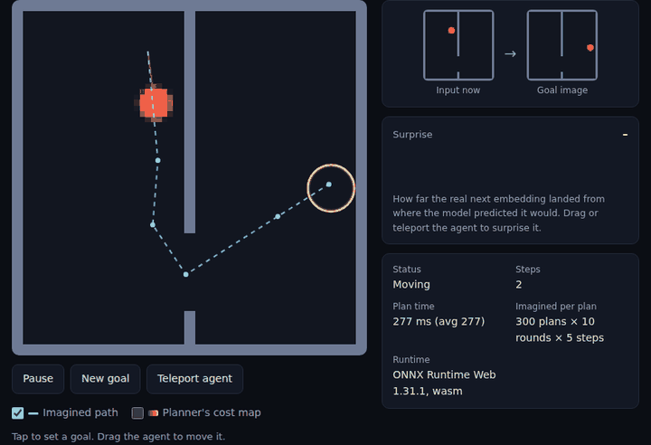

# LatentPlanner

A small JEPA world model that learned a two-room world from pixels, and plans routes in its own latent space,
live in the browser.

**Live demo: https://prathameshjadhav.in/latent-planner/** (runs entirely in your browser; works on phones)



- **Trained from pixels only.** 64×64 frames and actions; no rewards, positions or map. Objective is the LeWM
  recipe: predict the next embedding, plus SIGReg so embeddings can't collapse. No EMA target, no stop-gradient,
  no pixel reconstruction.
- **Plans by imagining.** The cross-entropy method samples action sequences, rolls the predictor forward in
  embedding space, and picks the one whose imagined future gets closest to the goal image's embedding.
- **Runs in the browser.** The environment is ported to JS bit-exactly (same pixels as training), the model is
  exported to ONNX (5.0 MB) and planning runs with ONNX Runtime Web.

## Results (100 fixed test tasks, half need the door)

| Method | Success | Other room |
|---|---|---|
| **Latent CEM, LeWM-style (λ=0.09), 3 seeds** | **100%** | **100%** |
| **Latent CEM, frameskip 4 (browser model), 3 seeds** | **100%** | **100%** |
| Same planner running in the browser (JS + ONNX Runtime Web) | 99% | 98% |
| Latent CEM without SIGReg (λ=0), 3 seeds | 6% | 1% |
| Oracle CEM: true simulator, straight-line cost | 87% | 74% |
| Straight line to goal (true positions) | 70% | 40% |
| Random actions | 11% | 2% |

SIGReg weight sweep: λ = 0 collapses, 0.01-0.09 all reach 100%, 0.3 gives 99%, 1.0 gives 93%
([details](results/RESULTS.md)). The model plans from the current frame and a goal image only. Without SIGReg the embedding collapses (std 0.0002)
and planning fails. ~5 min of training per model on a 4 GB laptop GPU; ~220 ms per re-plan in the browser.

**Second scene, "Push the block" (stretch goal):** the same recipe gets 39% of test pushes (74% of short ones; a
hand-written pusher gets 87%). The model's imagined contact dynamics are the weak spot; see the write-up.

Full numbers: [results/RESULTS.md](results/RESULTS.md). Write-up: [WRITEUP.md](WRITEUP.md).

## Reproduce

Needs Python 3.12 and a CUDA GPU (4 GB is enough; CPU works, slower). Everything below ran on an RTX 3050 Laptop
(4 GB) with 10.7 GB RAM.

```bash
uv venv --python 3.12 .venv && uv pip install --python .venv/bin/python -r requirements.txt

# 1. data: 2000 + 200 exploratory episodes, streamed to disk (peak RAM 0.15 GB, ~12 s)
.venv/bin/python -m latent_planner.data --episodes 2000 --seed 0 --out data/train
.venv/bin/python -m latent_planner.data --episodes 200 --seed 1 --out data/val

# 2. train the 9-run matrix (lambda 0.09 / 0 / frameskip 4, 3 seeds each, ~5 min per run)
scripts/train_all.sh

# 3. evaluate on 100 fixed test tasks + probes, then build the tables and plots
.venv/bin/python -m latent_planner.eval --baselines --taskset test --tag main --running-w 1.0
scripts/eval_all.sh
.venv/bin/python -m latent_planner.report --tag main

# 4. export the browser model and serve the demo locally
.venv/bin/python -m latent_planner.export --run runs/fs4_lam0.09_s0 --out web/model
python3 -m http.server -d web -b 127.0.0.1 8000

# tests: env dynamics/rendering, JS-vs-Python parity (needs node), headless browser smoke test
.venv/bin/python -m pytest -q tests
.venv/bin/python tests/web_smoke.py
```

## Layout

| Path | What |
|---|---|
| `latent_planner/env.py` | Two-room environment: dynamics, renderer, vectorised step for the oracle |
| `latent_planner/env_push.py`, `eval_push.py` | Scene 2 (push the block): environment, data policy, evaluation |
| `latent_planner/data.py` | Memory-bounded dataset generation (two behaviour policies) |
| `latent_planner/model.py` | Encoder, predictor, SIGReg, JEPA loss |
| `latent_planner/train.py` | Training loop, validation rollouts, position probe (diagnostic only) |
| `latent_planner/planner.py` | Batched CEM in latent space, oracle CEM on the true simulator |
| `latent_planner/eval.py` | Fixed test tasks, latent CEM vs baselines |
| `latent_planner/analyze.py` | Surprise and latent-geometry probes |
| `latent_planner/export.py` | ONNX export (fp16 weight storage) with ONNX Runtime parity check |
| `latent_planner/report.py` | Tables and plots from the logged CSVs |
| `web/` | The demo: `src/env.js` (bit-exact port), `src/cem.js`, `src/main.js` |
| `results/` | `eval.csv`, `analysis.csv`, `RESULTS.md`, plots, test tasks |
| `LOG.md`, `PLAN.md` | Build log with timestamps, and the plan |

## Credits

The objective follows LeWM (Maes et al., [code, MIT](https://github.com/lucas-maes/le-wm)) and SIGReg from LeJEPA
(Balestriero & LeCun, [arXiv 2511.08544](https://arxiv.org/abs/2511.08544)). Environment, model, planner and demo
are written from scratch here; no code is copied from the `lejepa` package (CC BY-NC 4.0) or other repositories.
