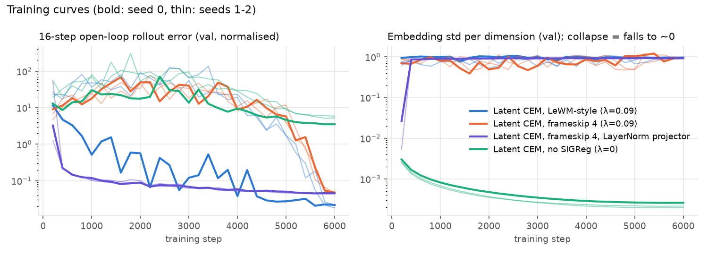
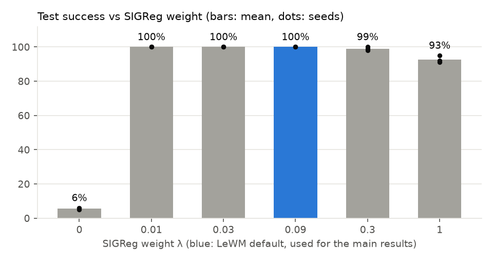

# LatentPlanner: a JEPA world model that plans in the browser

## Summary

We trained a small world model (1.1M-parameter CNN encoder, 93k-parameter MLP predictor) on 98k pixel frames
from a two-room environment, with the LeWM objective: predict the next embedding, plus SIGReg to keep the
embeddings from collapsing, with no EMA target, no stop-gradient and no pixel reconstruction. Planning is CEM in
embedding space toward the embedding of a goal image. The model never sees positions, rewards or a map.

On 100 fixed test tasks, half of which need the door, the planner reaches the goal in **100% of tasks for all
three training seeds**, both with one-step prediction and with 4-step frameskip (the browser model). The same
planner given the true simulator and straight-line distance reaches 87% (74% on other-room tasks). Without SIGReg
(λ = 0) the embedding collapses and success drops to 6%, below random actions (11%).

Everything runs on a 4 GB laptop GPU in about 5 minutes per model, and the planner runs in the browser with ONNX
Runtime Web.

## Setup

**Environment.** A 64×64 arena with a 2 px border and a vertical wall with a 14 px door. The agent is a radius-3
disc; actions in [-1, 1]² move it up to 5 px per step (5 substeps, axis-separated collision against
axis-aligned walls). The renderer anti-aliases the disc with 4×4 supersampling. The environment is written twice,
NumPy for training and JS for the browser, with the same float64 operations in the same order: positions match
exactly and frames match pixel for pixel (`tests/test_js_parity.py`), so the browser shows the model exactly the
kind of frames it was trained on.

**Data.** 2,000 training and 200 validation episodes of 48 steps from two behaviour policies: a sticky random walk
(60%) and a noisy go-to-random-waypoint controller that routes through the door (40%). 56% of episodes cross the
door. The policies' targets are never shown to the model. Generation streams frames to disk in chunks (peak RAM
0.15 GB; see "Engineering notes").

**Model.** Encoder: four stride-2 4×4 convolutions (32-64-128-128 channels, GELU), a linear layer to 256, and a
LeWM-style projector (Linear-BatchNorm-GELU-Linear) to a 32-d embedding z. Predictor:
z_{t+k} = z_t + MLP([z_t, emb(a_t..a_{t+k-1})]) with two 256-unit LayerNorm-GELU layers, where k is the frameskip
(1 or 4).

**Objective.** loss = mean over one-step and open-loop multi-step (up to 8 predictor steps) prediction errors
‖ẑ − z‖² + λ·SIGReg(z). Gradients flow into both sides of the prediction loss; SIGReg alone prevents collapse.
SIGReg follows the LeJEPA paper: project the batch of embeddings onto 512 random unit directions and compare each
1-D empirical characteristic function with N(0, 1)'s using the Epps–Pulley statistic (17 trapezoid knots on
[0, 3], Gaussian window), applied per time step over the batch. We wrote it from the paper and checked it against
LeWM's MIT implementation; the `lejepa` package is CC BY-NC, so it isn't used.

**Training.** 6,000 steps, batch 64 windows of 9 frames (frameskip 1) or 9 frames spaced 4 apart (frameskip 4),
AdamW (lr 1e-3, cosine, 200 warm-up steps, weight decay 1e-4), gradient clipping 1.0. The uint8 dataset lives on
the GPU (1.2 GB). 5 minutes per run on an RTX 3050 Laptop; host RAM peak 1.8 GB, GPU peak 2.6 GB.

**Planner.** CEM over K = 5 action knots, each held for 4 env steps (20 env steps of lookahead, enough for the
longest path through the door), 300 samples, 30 elites, 10 iterations, momentum 0.1. Cost of a plan:
‖z_H − z_goal‖² + 1.0 · mean_t ‖z_t − z_goal‖² over the imagined latents. Model-predictive control: execute the
first knot (4 steps), re-encode the new frame, re-plan, warm-starting from the shifted previous plan.

**Evaluation.** 100 fixed test tasks (seeded, saved in `results/tasks_test.json`); half start and end in
different rooms. Success: agent centre within 4 px of the goal centre at any step within 50 env steps. All
planner settings were chosen on a separate set of 100 tuning tasks. Three training seeds per configuration, one
planning seed each. Baselines: random actions; a straight line to the goal using the true positions; and oracle
CEM, the same CEM with the true simulator and the true straight-line distance as cost.

## Results

### Goal reaching (100 fixed test tasks, 50-step budget, success = within 4 px)

| Method | Seeds | Success | Same room | Other room | Steps (successes) | Per-seed success |
|---|---|---|---|---|---|---|
| Latent CEM, LeWM-style (λ=0.09) | 3 | 100 ± 0% | 100 ± 0% | 100 ± 0% | 10.3 | 1.00, 1.00, 1.00 |
| Latent CEM, frameskip 4 (λ=0.09) | 3 | 100 ± 0% | 100 ± 0% | 100 ± 0% | 9.4 | 1.00, 1.00, 1.00 |
| Latent CEM, frameskip 4, LayerNorm projector | 3 | 99 ± 0% | 100 ± 0% | 99 ± 1% | 9.4 | 0.99, 1.00, 0.99 |
| Same planner in the browser (JS + ONNX Runtime Web, ln_fs4_lam0.09_s0) | 1 | 100% | 100% | 100% | 9.8 | 1.00 |
| Latent CEM, no SIGReg (λ=0) | 3 | 6 ± 0% | 10 ± 2% | 1 ± 1% | 16.2 | 0.06, 0.06, 0.05 |
| Oracle CEM: true simulator, straight-line cost | - | 87% | 100% | 74% | 6.8 | - |
| Straight line to goal (true positions) | - | 70% | 100% | 40% | 5.6 | - |
| Random actions | - | 11% | 20% | 2% | 28.2 | - |

Mean ± std over training seeds (one planning seed each). Baselines run once (seeded).

"Steps" averages over each method's own successes, so it isn't comparable across rows with different success
rates (the oracle and straight-line baselines mostly succeed on the easier tasks).

### Probes (validation data; diagnostics, never used by the planner)

| Config | 16-step rollout error | Embedding std | Effective rank (of 32) | Position probe RMSE (px) | Surprise AUROC | Latent vs geodesic ρ | Latent vs straight-line ρ | Cost basin radius (px) |
|---|---|---|---|---|---|---|---|---|
| Latent CEM, LeWM-style (λ=0.09) | 0.021 ± 0.002 | 0.96 | 23.7 ± 0.3 | 0.77 ± 0.15 | 1.000 ± 0.000 | 0.36 ± 0.01 | 0.35 ± 0.01 | 12.0 ± 0.0 |
| Latent CEM, frameskip 4 (λ=0.09) | 0.047 ± 0.000 | 0.93 | 16.7 ± 0.1 | 0.81 ± 0.03 | 0.997 ± 0.000 | 0.50 ± 0.01 | 0.52 ± 0.01 | 14.7 ± 0.9 |
| Latent CEM, no SIGReg (λ=0) | 4.888 ± 0.997 | 0.0002 | 30.6 ± 0.3 | 21.33 ± 0.90 | 0.533 ± 0.026 | 0.17 ± 0.03 | 0.17 ± 0.03 | 2.0 ± 0.0 |

Rollout error is normalised by the latent variance (1.0 = no better than the mean embedding). Surprise AUROC separates real next frames from teleports using the prediction error. Effective rank is scale-invariant, so it stays high for a collapsed model (tiny isotropic noise); embedding std shows the collapse.

## Findings

**1. A final-state cost doesn't work under receding-horizon control.** With only ‖z_H − z_goal‖², every re-plan
puts the goal at the end of a fresh 20-step window, so the agent drifts and rarely passes within 4 px. The oracle
with true dynamics showed it first (24% success on the tuning tasks). Adding the running term fixed it for both
the oracle and the latent planner.

**2. The latent cost is not a map, and that turns out to help.** Latent distance correlates only weakly with
geodesic or straight-line distance (Spearman ρ in the table above). Around any goal it forms a sharp basin about
12 px wide; beyond it the distance keeps rising, but only slowly. For the frameskip-4 model the median latent
distance goes from 1.6 at 0-4 px of path to 7.5 at 16-20 px, then only to 9.4 at 80-110 px
(`results/horizon/latent_vs_px.txt`). The planner crosses rooms because the learned dynamics stop plans at walls
and the 20-step horizon reaches the basin; with shorter horizons CEM can still follow the weak far-field slope
(see finding 8). The weak far field also avoids the trap that catches the straight-line oracle: pressing against
the wall right next to a goal in the other room earns little in latent space, while in true straight-line distance
it looks almost as good as arriving. (An earlier draft called the far field flat and said goals beyond the
horizon give no signal; the horizon experiment below showed that was too strong.) The demo's "cost map" toggle
shows this landscape for whatever goal you click.

**3. Without SIGReg the embedding collapses.** With λ = 0 every seed's embedding shrinks to a standard deviation
of ~3e-4 (vs ~0.95), the prediction loss falls to ~2e-7 because predicting a constant is trivial, and a linear
probe can't recover position (20-22 px RMSE, chance level). Effective rank is misleading here: it reads ~31/32
for the collapsed models because it is scale-invariant and the leftover noise is isotropic.

**4. Surprise is a reliable signal.** The predictor's error on the real next frame is ~600× smaller than its
error against a frame from a random other state (median 0.003 vs 1.9 for frameskip 1), so a teleport is
detected with AUROC 1.00 (0.997 for frameskip 4). The collapsed λ = 0 models are at chance (0.53). The demo's surprise meter plots this error live; dragging the agent makes it spike.

**5. Validation rollouts are unstable until the learning rate decays.** For seed 0 of the frameskip-1 model the
16-step validation error falls early; for the other two seeds and all three frameskip-4 seeds it stays at 10-100×
the latent variance for most of training and only drops in the last ~1,500 steps of the cosine schedule (see the
training curves). Every final model is good, but the result leans on the schedule. Validation runs the encoder in
eval mode, and the projector's BatchNorm sees pre-normalisation features with running variance of only 1e-7 to
7e-5, so small drifts in its running statistics get amplified; the same amplification is why fp16 weights break
the frameskip-4 encoder. Replacing that BatchNorm with LayerNorm fixed both (finding 9).

**6. Frameskip 4 is the browser model.** Predicting 4 env steps at a time (LeWM uses 5) cuts the predictor calls
per plan by 4×. Planning in Chrome on this laptop drops from ~800 ms to ~220 ms per re-plan (~0.9 s with 4× CPU
throttling as a phone stand-in) with the same CEM budget, and test success stays at 100%. Its latent space is
also somewhat more map-like (ρ ≈ 0.50 vs 0.36, basin ~15 px vs 12 px).

**7. SIGReg needs to be on, but not strong.** A sweep of the SIGReg weight (3 seeds each, the extra runs on a
free Kaggle T4) shows a cliff and then a slow decline: λ = 0 collapses (6%), every λ from 0.01 to 0.09 reaches 100%,
and larger weights make the embedding fit the Gaussian target at the expense of prediction: 16-step rollout error
grows from 0.010 (λ = 0.01) to 0.057 (λ = 1), the position read-out degrades from 0.26 to 2.93 px, and success
drops to 99% (λ = 0.3) and 93% (λ = 1, 86% on other-room tasks). The LeWM default of 0.09 sits in the flat region;
on this environment 0.01-0.03 is slightly better on every probe and gives shorter paths (8.6-9.1 vs 10.3 steps).

### SIGReg weight sweep (frameskip 1, same test tasks)

| λ | Seeds | Success | Other room | Embedding std | 16-step rollout error | Position probe RMSE (px) | Surprise AUROC | Trained on |
|---|---|---|---|---|---|---|---|---|
| 0 | 3 | 6 ± 0% | 1 ± 1% | 0.0002 | 4.888 | 21.33 | 0.533 | GeForce RTX 3050 Laptop GPU |
| 0.01 | 3 | 100 ± 0% | 100 ± 0% | 0.9187 | 0.010 | 0.26 | 1.000 | Tesla T4 |
| 0.03 | 3 | 100 ± 0% | 100 ± 0% | 0.9421 | 0.014 | 0.39 | 1.000 | Tesla T4 |
| 0.09 | 3 | 100 ± 0% | 100 ± 0% | 0.9614 | 0.021 | 0.77 | 1.000 | GeForce RTX 3050 Laptop GPU |
| 0.3 | 3 | 99 ± 1% | 99 ± 1% | 0.9776 | 0.038 | 1.64 | 1.000 | Tesla T4 |
| 1 | 3 | 93 ± 2% | 86 ± 3% | 0.9876 | 0.057 | 2.93 | 1.000 | Tesla T4 |

λ = 0.09 is the LeWM default used for the main results. Runs other than λ ∈ {0, 0.09} were trained and evaluated on a free Kaggle T4 from the same seeds and code (dataset regenerated there; sha256 matches the local data).

### Cross-hardware re-run

λ = 0.09, seed 0, retrained on a Kaggle T4 with the same code and data: success 100% (same room 100%, other room 100%), 10.2 steps; the local RTX 3050 run of the same seed scored 100%.

**8. Longer tasks: subgoals from a latent waypoint graph.** Shrinking the planning horizon shows where it breaks:
with frameskip-4 models (3 seeds) test success is 100% at 20 steps, 99% at 12 and 8 steps, and 81% at 4 steps. On
100 extra cross-room tasks with paths of at least 70 px ("far") it falls to 83% at 8 steps and 50% at 4. The fix
uses only embeddings: a graph over 5,200 embeddings of training frames (edges between consecutive frames, plus
near neighbours under a latent-distance threshold calibrated on those transitions), a shortest-path search from
the current embedding to the goal's, and CEM aimed at the first node at or beyond one horizon along that path.

| Tasks, horizon | Plain CEM | With subgoals |
|---|---|---|
| test, 4 steps | 81% | **98%** |
| far, 4 steps | 50% | **83%** |
| far, 8 steps | 83% | **100%** |
| test or far, 20 steps | 99-100% | 99-100% (unchanged) |

How the subgoal is chosen matters more than the graph: aiming at the farthest node *within* one horizon often
picked a node ~1 px away, the agent stalled, and success fell to 2% on far tasks at 4 steps. The "beyond" rule was
chosen on the tuning tasks; the far task set was designed after seeing the short-horizon numbers. Details:
[results/horizon/SUBGOAL.md](results/horizon/SUBGOAL.md).

**9. A LayerNorm projector fixes the late-settling training.** Swapping the projector's BatchNorm for LayerNorm
(frameskip 4, 3 seeds, everything else equal) makes the 16-step validation error drop below 0.2 by step 600,
against step ~5,800 with BatchNorm (0.11 vs 25 at step 1,000). The final models are slightly sharper (read-out
0.50-0.62 px vs 0.80 px; rollout error 0.043-0.046 vs 0.047), and test success is 99/100/99% vs 100/100/100%:
two misses in 300 tasks, within noise. Its encoder also survives fp16 weight storage (error 0.00045 vs 0.07),
which roughly halves the browser download, so the demo now runs the LayerNorm model (seed 0): its browser planner
scores 100% on the test tasks with 2.8 MB of model files, against 99% and 5.0 MB for the BatchNorm model it
replaced.

## Scene 2: Push (stretch goal, partly works)

The second scene is a walled room with an 8×8 px block that the agent pushes. Pushing is kinematic and
axis-separated: the block moves with the agent and stops at walls, with no momentum or rotation. Like the
two-room env it is ported to JS bit-exactly. The data is 2,000 episodes (70% from a policy that walks behind the
block and pushes it in random directions, 30% sticky random walk), and the model, objective, training and planner
are unchanged (frameskip 4, λ = 0.09, 3 seeds). Each test goal is the end state of a real 30-step push, so the goal
image shows the agent where a pusher would be.

### Test results (100 fixed test tasks, 60-step budget, success = block within 3 px)

| Method | Seeds | Success | Short push (< 20 px) | Long push | Steps (successes) | Per-seed |
|---|---|---|---|---|---|---|
| Latent CEM (λ=0.09, frameskip 4) | 3 | 39 ± 1% | 74 ± 0% | 19 ± 2% | 11.2 | 0.40, 0.37, 0.39 |
| Hand-written pusher (true positions) | - | 87% | 100% | 80% | 23.3 | - |
| Oracle CEM: true simulator, state-distance cost | - | 64% | 91% | 49% | 11.1 | - |
| Random actions | - | 1% | 3% | 0% | 9.0 | - |

100 fixed test tasks; each goal is the end of a 30-step push from the start. Success = block within 3 px of its target within 60 steps; long = the block must move 20 px or more. Mean ± std over 3 training seeds.

#### Variants tried on the tuning tasks (seed 0 unless noted)

| Run | Planner | Success | Short | Long | Block read-out error (px) |
|---|---|---|---|---|---|
| push_fs4_s0 | K5xh4 S300 I10 rw1.0 | 32% | 53% | 23% | 4.3 |
| push_fs4_s0 | K8xh4 S300 I10 rw1.0 | 32% | 57% | 21% | 4.3 |
| push_fs4_s0 | K4xh8 S300 I10 rw1.0 | 27% | 50% | 17% | 4.3 |
| push_fs4_s1 | K5xh4 S300 I10 rw1.0 | 31% | 57% | 20% | 4.0 |
| pushv_l0.01_fs4_15k_s0 | K5xh4 S300 I10 rw1.0 | 17% | 40% | 7% | 13.7 |

**What didn't work, and why.** The planner gets 74% of short pushes but only 19% of long ones, against 87% / 80% for
a hand-written pusher with true positions. In failures it does push the block, just not toward the target, so the
problem is the model's imagined contact dynamics, not the search:

- **Prediction is much worse than in two rooms.** 16-step rollout error is ~0.18 vs 0.048, and a linear read-out
  finds the block only to ~4 px (0.8 px for the agent in two rooms). Contacts are rare in the data (the block moves
  on ~26% of push-policy steps and ~4% of wander steps), so the predictor sees few of them.
- **A longer horizon doesn't help:** 32% (20 steps), 32% (32 steps), 27% (32 steps with coarser holds) on the
  tuning tasks.
- **Weaker SIGReg makes it worse, in an instructive way.** λ = 0.01 with 2.5× more training gives excellent
  rollout error (0.011-0.016) but the block read-out degrades to 13.7 px and success drops to 17%: the model learns
  to mostly ignore the rarely-moving block, which makes its embeddings easy to predict and useless for pushing.
  Good prediction loss is not evidence of a good planning representation.
- Not tried, given the time box: more push-heavy data, a bigger latent or predictor, and LeWM's longer history
  (3 frames).

## Browser demo

`web/` is a static page: `env.js` (bit-exact port of the environment), `cem.js` (the same CEM as
`planner.py`, with one ONNX call per CEM iteration scoring all 300 samples over the full horizon), and `main.js`
(loop, drawing, input). The encoder and the unrolled predictor are exported to ONNX and run with ONNX Runtime Web
1.31.1 on wasm (one thread, since static hosting has no cross-origin isolation). Large weights are stored as fp16
with a Cast back to fp32 when ONNX Runtime's output stays within 2e-2 of PyTorch. The original BatchNorm
frameskip-4 encoder failed that check (its projector BatchNorm sees features with running variance ~1e-7, which
amplifies rounding upstream) and shipped as fp32; the LayerNorm model now in the demo passes it (finding 9). The imagined path is drawn with a linear probe from z to (x, y) fitted after training; the
planner never uses it. The cost map uses precomputed embeddings of a 1 px grid of positions.

Tested headless in Chrome and WebKit at 1200×900 and 390×844 (`tests/web_smoke.py`): the page loads, plans and
reaches goals with no horizontal overflow.

## Limitations

- The environment is tiny and fully observed: one frame is a complete state, the dynamics are deterministic,
  and there are no distractors. This shows the recipe working end to end, not that it scales.
- With short horizons the planner fails on long tasks unless it plans through subgoals (finding 8); the waypoint
  graph needs a dense bank of training frames, which is easy in a world this small.
- One planning seed per trained model; the spread across seeds is training variance only.
- The demo uses one model (frameskip 4, LayerNorm projector, seed 0); the evaluation numbers cover all three
  seeds. Its browser planner (same algorithm, JS random numbers, ONNX Runtime Web, fp16 weights) scores 100% on
  the test tasks. The BatchNorm model it replaced scored 99% in the browser; that one miss had its goal in the
  corner of the doorway.

## Engineering notes

- **The first run of the data generator was OOM-killed** (9.2 GB RSS on a 10.7 GB machine): `render_batch` was
  called on all 98k states at once and built a float64 copy of every frame. It now renders 64 episodes at a time
  into a uint8 buffer, appends the bytes to `frames.npy` behind a pre-written header (no memmap, so written pages
  don't count toward RSS), and aborts above 3 GB. Peak RSS is 0.15 GB.
- Training reads the frames with plain file reads and uploads them to the GPU in chunks, so host RSS stays at
  ~1.8 GB (most of it CUDA libraries).
- Extra runs (the λ sweep) ran on a free Kaggle T4 through a private script kernel with the code embedded
  (`scripts/kaggle_run.py`). The kernel regenerates the dataset from its seeds and prints sha256 hashes, which
  match the local data.

## References

- LeWM: Maes et al., code at github.com/lucas-maes/le-wm (MIT). Objective, projector design and SIGReg settings.
- LeJEPA / SIGReg: Balestriero & LeCun, arXiv 2511.08544.
- Related planning-with-latent-dynamics work on two-room navigation: PLDM, DINO-WM, EB-JEPA (all read for
  context; no code used).
